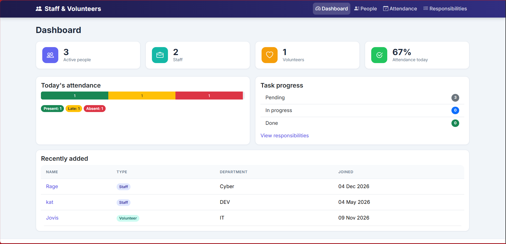
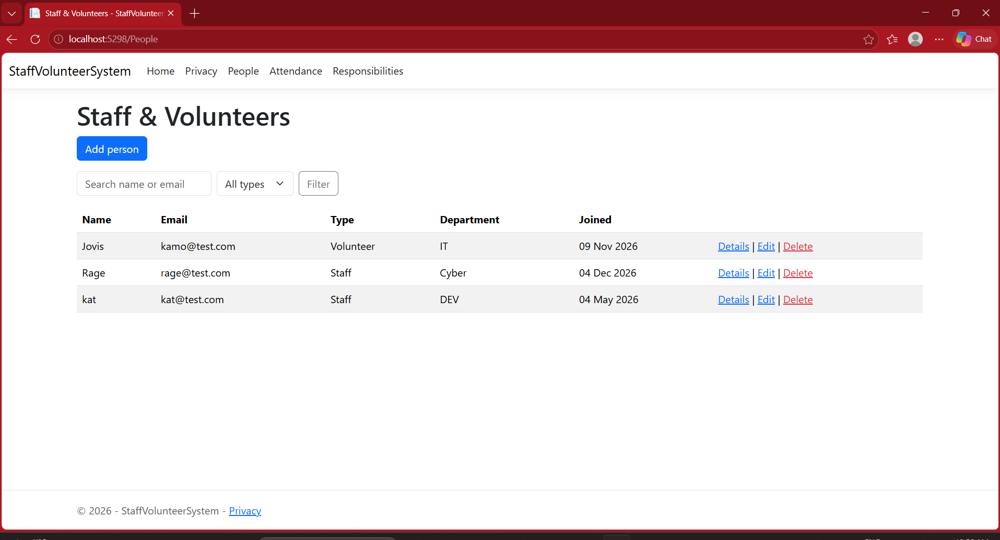
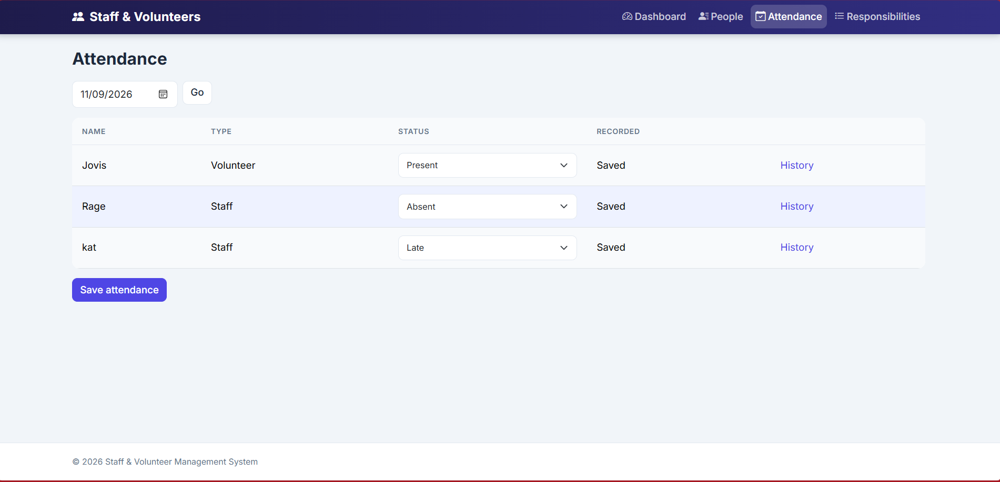
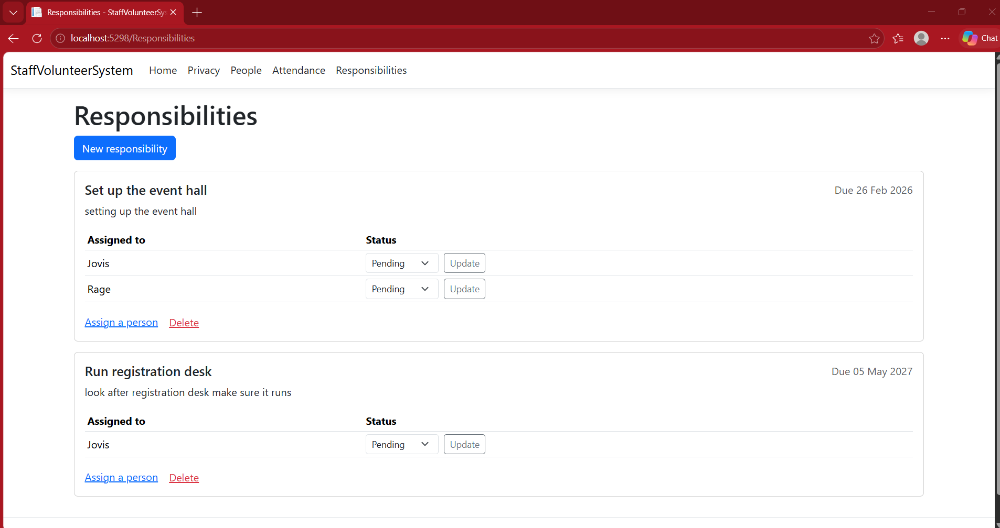

# Staff & Volunteer Management System

A web application for registering staff and volunteers, managing their profiles, recording daily attendance, and assigning responsibilities. Built with ASP.NET Core MVC, Entity Framework Core and SQLite.



## Features

- **People:** register staff and volunteers, view profiles, edit and delete, search by name or email, filter by type
- **Attendance:** mark Present, Late or Absent per day, with a per-person history and totals
- **Responsibilities:** create tasks with due dates, assign people, and track Pending, In Progress or Done
- **Dashboard:** headcount, today's attendance rate, task progress and recently added people

## Screenshots

| People | Attendance |
|---|---|
|  |  |



## Tech stack

- C# / .NET 10
- ASP.NET Core MVC (Razor views)
- Entity Framework Core with SQLite
- Bootstrap 5

## Getting started

```bash
git clone https://github.com/moorosikamohelo32-cmd/StaffVolunteerSystem.git
cd StaffVolunteerSystem
dotnet ef database update
dotnet run
```
Then open the URL shown in the terminal (for example http://localhost:5298).

## Project structure

- `Models/` entities and view models
- `Data/` the EF Core database context
- `Controllers/` People, Attendance, Responsibilities and Home
- `Views/` Razor pages for each feature
- `Migrations/` database schema history

## Planned improvements

- Login with admin and manager roles
- Export attendance reports to CSV or PDF
- Unit tests for the controllers

## Author

[Kamohelo Moorosi] | [moorosikamohelo32@gmail.com]